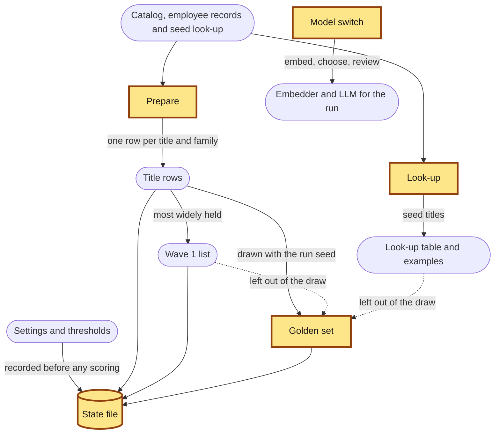
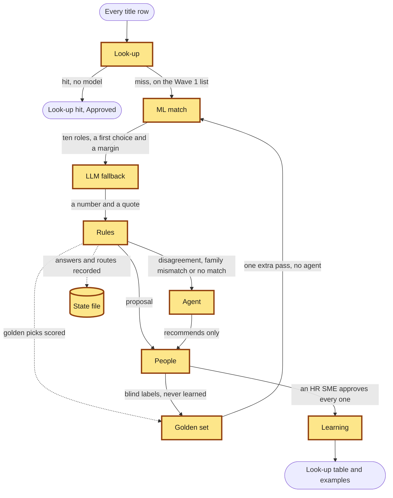
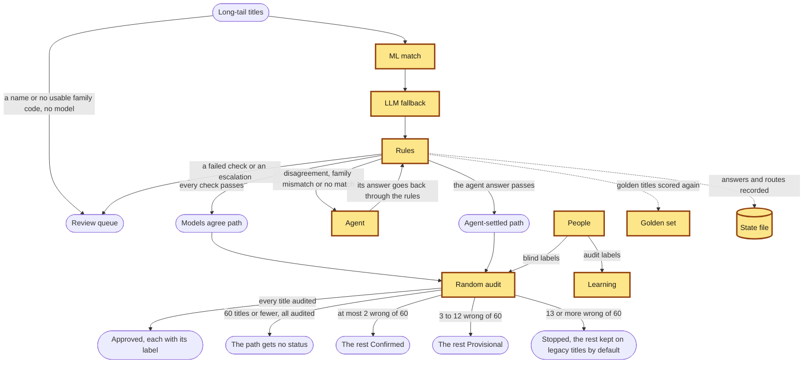
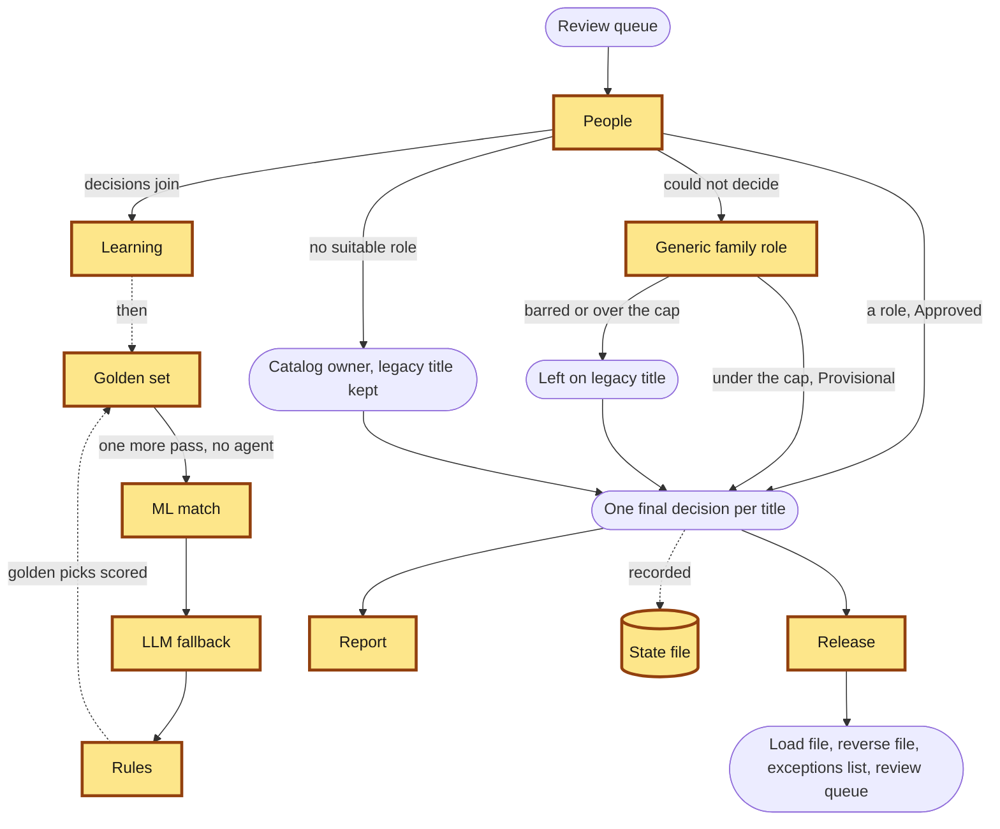

# The architecture page

A local page that shows each stage of a run as a flowchart, the components that act in it, and
each component's job in the words of `DESIGN.md`, beside counts read from the state file of a
run. It is `titlestd/explorer.py`, on the standard library and the two browser libraries in
`static/vendor/`.

## Starting it

From the repository root, make a free run first, then start the page:

```sh
python3 -m titlestd run
python3 -m titlestd.explorer
```

Open http://127.0.0.1:7654/ and stop the page with Ctrl+C. It opens `out/state.sqlite`
read-only and answers only at that address and only to GET. For a run made with `--out-dir`,
pass the page the same `--out-dir`. It does not start without a state file, and it shows only a
free run: one whose `llm` setting is `offline` or `replay` and none of whose answers is labelled
live. A later run replaces the file, and the page then shows the new one. While that run is
under way, or when a run stopped, the page shows the state as it stood at the last completed
step, and says so above each table of counts. What a run writes only at its end, such as the
final decisions and the audits, then reads "not yet". Until set-up has recorded the run's
settings, the page answers that the state is not a free run's.

## What it shows

- A page per stage: the row of the stage in `DESIGN.md` 1.10, the stage as a flowchart with the
  components acting in it drawn with a heavy border and listed again as text, and counts from
  the state file.
- A page per component: its job quoted from `DESIGN.md`, its module, the entries of
  `docs/build-decisions.md` that govern it, the stages it acts in, and counts from the state
  file.

The counts are numbers of rows in the state file and labels defined in the code. No title,
description, quote or other text of a record is shown.

## The four flowcharts

These are the flowcharts the page draws, word for word; a test holds the two equal. Each draws
one stage as `titlestd/pipeline.py` runs it. The nodes with a heavy border are the components
acting in that stage; the others are inputs, lists and outcomes. They are drawn from the code.
The two older diagrams in `docs/`, `architecture-microsoft.png` and
`architecture-tech-agnostic.png`, are the ones `DESIGN.md` says not to copy.

### Set-up



### Wave 1



### Wave 2



### Close

The close is the mock's Wave 3: people clear the queue, leftovers take a generic family role,
and the files are released.


